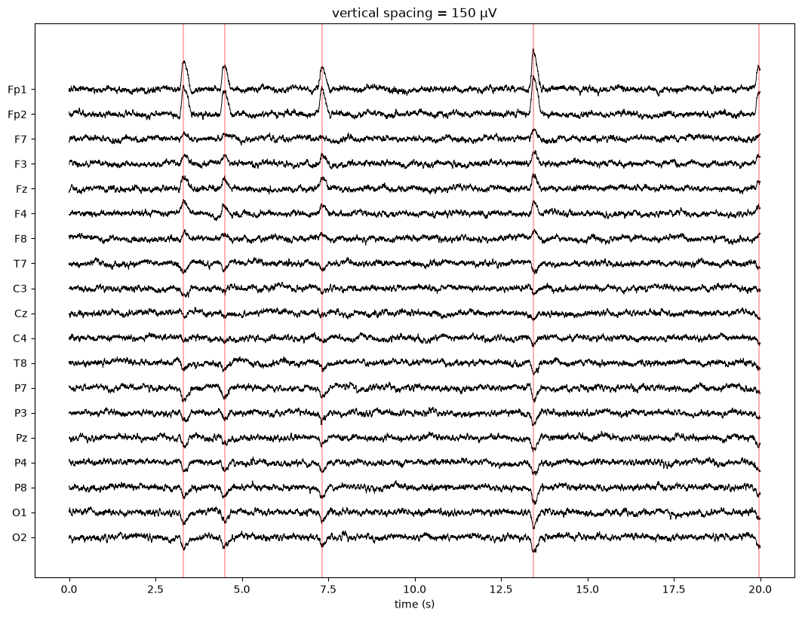
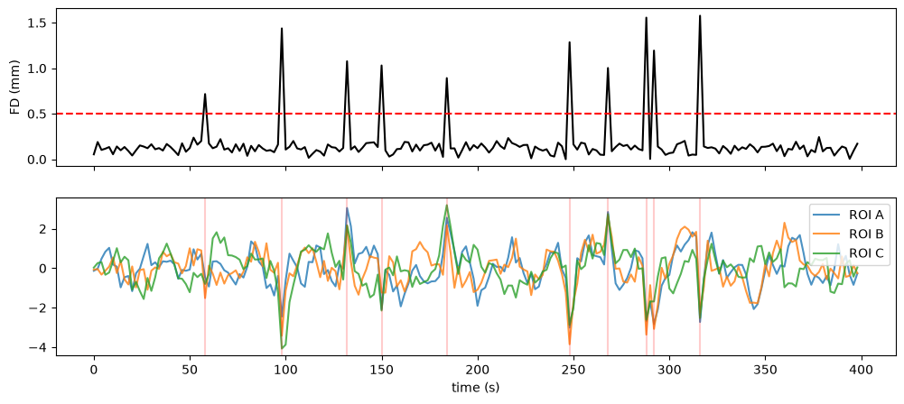

# Connectome Lab Challenges

**서울대학교 심리학과 Connectome Lab이 만든, 뇌 데이터를 직접 다뤄 보는 연습 챌린지입니다.** 뇌파(EEG)와 뇌 영상(fMRI)을 그려 보고, 이상한 점을 찾고, 그 이유를 근거와 함께 설명합니다. 정답을 맞히는 시험이 아니라, 이런 연구가 나와 맞는지 스스로 가늠해 보는 학습 기회입니다.

연구실 밖 학부생·대학원생 누구나 참여할 수 있고, 비용과 신청 절차는 없습니다. **처음 오셨다면 [시작 안내](START_HERE.md)부터 읽어 주세요.** 설치부터 첫 결과까지 30분 안팎이면 됩니다.

## 챌린지

| 챌린지 | 무엇을 배우나 | 난이도 | 걸리는 시간 (추정) |
| --- | --- | --- | --- |
| [EEG · 뇌파에서 눈 깜빡임 흔적 찾아보기](challenges/eeg.md) | 뇌파에 섞여 든 눈 깜빡임(아티팩트)을 찾고, 그것이 뇌가 아니라 눈에서 왔다는 근거를 채널 위치·모양·부호로 설명하기 | L1 | 2–3시간 + 실제 데이터 1시간 |
| [fMRI · 뇌 영역의 신호는 함께 움직일까?](challenges/fmri.md) | 두 영역의 상관을 계산하고, 머리 움직임이 관계없는 영역 사이에 가짜 상관을 만드는 함정을 찾아 보정하기. 상관이 인과가 아닌 이유 설명하기 | L1 | 2–3시간 + 실제 데이터 1시간 |



*EEG 챌린지에서 만드는 그림: 이마 채널(Fp1, Fp2)에서 크게 솟는 파형이 눈 깜빡임입니다. 빨간 선은 자동으로 찾은 시점입니다.*



*fMRI 챌린지에서 만드는 그림: 머리가 크게 움직인 순간(위, 빨간 점선 위로 솟은 곳)에 서로 관계없는 영역까지 함께 출렁입니다(아래).*

**L1**은 안내를 따라 실행하고 본 것을 설명하는 수준입니다. 학년이나 학위에 따른 참가 제한이 아닙니다.

## 진행 순서

1. **설치**: Python 3.11 또는 3.12와 노트북 컴퓨터(GPU 필요 없음)만 있으면 됩니다. [시작 안내](START_HERE.md#4-설치와-첫-실행-30분-안팎)를 따라 설치하고 첫 노트북을 실행합니다.
2. **합성 데이터로 연습**: 컴퓨터로 만든 합성 데이터에는 정답 파일이 함께 들어 있어, 내 분석을 스스로 확인할 수 있습니다.
3. **실제 공개 데이터로 확인 (선택)**: 누구나 받을 수 있는 공개 데이터(PhysioNet EEGBCI 약 8 MB, OpenNeuro ds000228 약 50 MB)에 같은 분석을 적용하고, 합성 데이터와 무엇이 다른지 설명합니다. 실제 데이터에는 정답이 없고, 데이터마다 이용 조건과 인용 요구가 있습니다(각 챌린지 문서에 적었습니다).
4. **정리와 공유 (선택)**: 그림·노트북·짧은 설명을 정리하고, 원하면 Issues에 결과를 공유해 의견을 받습니다.

필요한 배경지식은 Python 기초 문법 정도입니다. 뇌 데이터 용어는 문서와 노트북에서 설명합니다.

## 폴더 구조

```text
START_HERE.md        시작 안내: 설치, 첫 실행, 공유·질문 방법, 자주 묻는 질문
challenges/eeg.md    EEG 챌린지 안내
challenges/eeg/      EEG 합성 데이터 생성기, 예제 노트북, 실제 데이터 노트북
challenges/fmri.md   fMRI 챌린지 안내
challenges/fmri/     fMRI 합성 데이터 생성기, 예제 노트북, 실제 데이터 노트북
CODE_OF_CONDUCT.md   이슈·댓글에서 지켜 주실 것
```

## 질문과 공유

막힌 곳, 질문, 결과 공유는 이 저장소의 **Issues** 탭에서 양식(질문하기·결과 공유하기·문서 오류 제보)을 골라 남겨 주세요. 답변은 연구실 구성원이 가능한 범위에서 드리며, 응답 시간은 보장하지 않습니다. 자세한 방법은 [시작 안내](START_HERE.md#5-결과-정리와-공유)에, 지켜 주실 것은 [행동 규칙](CODE_OF_CONDUCT.md)에 있습니다.

## 라이선스

코드(`.py`, `.ipynb`의 코드)는 [MIT 라이선스](LICENSE), 문서와 그림은 [CC BY 4.0](LICENSE-docs)을 따릅니다. 출처를 밝히면 자유롭게 고치고 다시 쓸 수 있습니다. 실제 공개 데이터는 각 데이터셋의 이용 조건을 따릅니다.

## English summary

Hands-on practice challenges for analyzing brain data, made by the Connectome Lab, Department of Psychology, Seoul National University. Each challenge starts with synthetic EEG or fMRI data that comes with ground truth, so you can check your own analysis, and then (optionally) applies the same analysis to openly available datasets (PhysioNet EEGBCI, OpenNeuro ds000228). Everything runs on a laptop with Python 3.11 or 3.12. The documents are in Korean. Questions are welcome in the Issues tab, in English or Korean.
