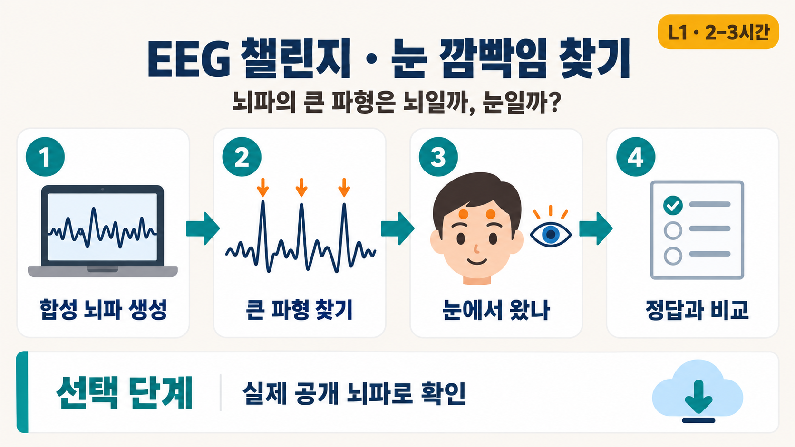
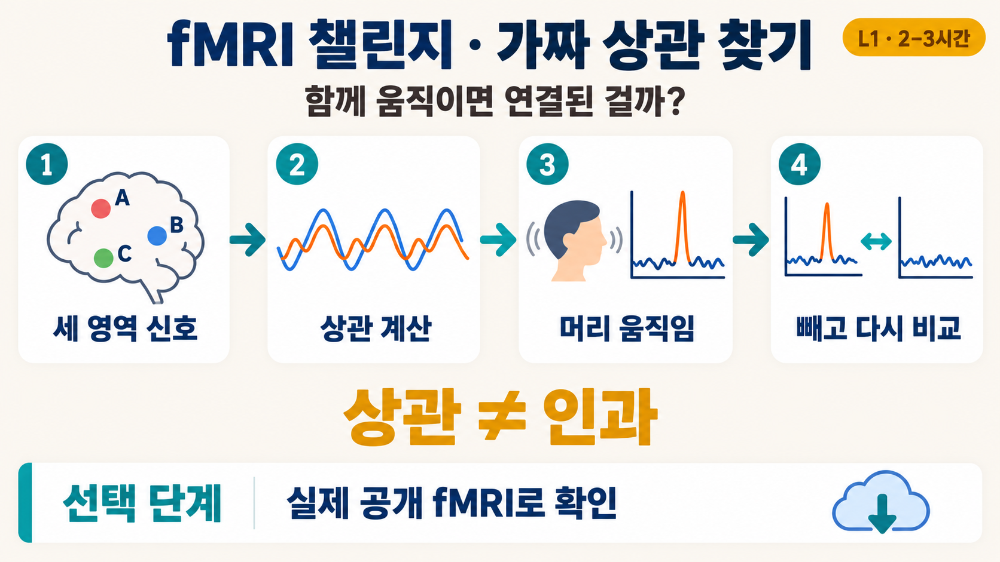
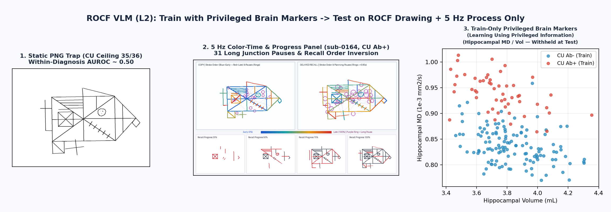
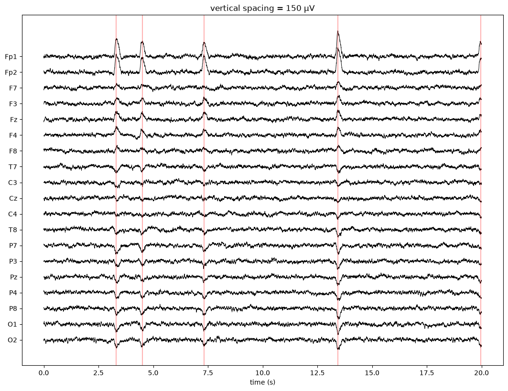
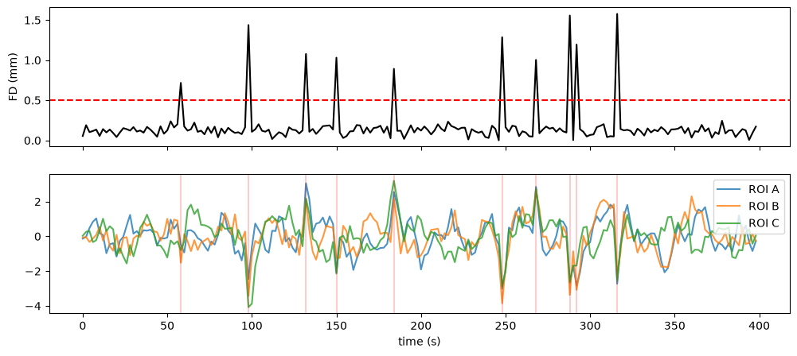
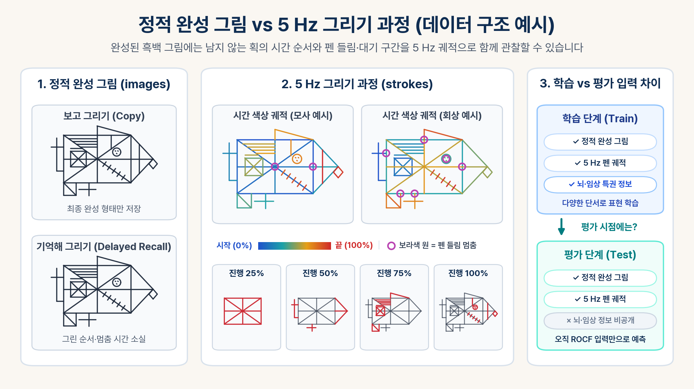

# Connectome Lab Challenges

**서울대학교 심리학과 Connectome Lab이 만든, 뇌·인지행동 데이터를 직접 다뤄 보는 오픈 챌린지입니다.** 입문용 **L1** 연습 챌린지 2종(뇌파 EEG, 뇌 영상 fMRI)과 심화용 **L2** 챌린지 1종(복합도형 그리기 과정 ROCF VLM)으로 구성되어 있습니다. 데이터를 그려 보고, 교란과 함정을 찾고, 분석과 모델이 타당한지 근거와 반증 대조군으로 검증합니다. 정답을 맞히는 시험이 아니라, 이런 연구가 나와 맞는지 스스로 가늠해 보는 학습 기회입니다.

연구실 밖 학부생·대학원생 누구나 참여할 수 있고, 비용과 신청 절차는 없습니다. **처음 오셨다면 [시작 안내](START_HERE.md)부터 읽어 주세요.** 설치부터 첫 결과까지 30분 안팎이면 됩니다.

## 챌린지

| 챌린지 | 무엇을 배우나 | 난이도 |
| --- | --- | --- |
| [EEG · 뇌파에서 눈 깜빡임 흔적 찾아보기](challenges/eeg.md) | 뇌파에 섞여 든 눈 깜빡임(아티팩트)을 찾고, 그것이 뇌가 아니라 눈에서 왔다는 근거를 채널 위치·모양·부호로 설명하기 | L1 |
| [fMRI · 뇌 영역의 신호는 함께 움직일까?](challenges/fmri.md) | 두 영역의 상관을 계산하고, 머리 움직임이 관계없는 영역 사이에 가짜 상관을 만드는 함정을 찾아 보정하기. 상관이 인과가 아닌 이유 설명하기 | L1 |
| [ROCF VLM · 복합도형 그리기 과정으로 아밀로이드 베타 예측하기](challenges/rocf_vlm.md) | 정적 그림·점수의 진단군 교란(`CU + MCI`)과 천장효과를 통제하고, 5 Hz 디지털 펜 그리기 과정(시계열·진행 패널) 신호를 모델링해 신호 진위를 자체 검증하기 | L2 |

**걸리는 시간과 난이도 (추정)**: **L1** 연습 챌린지 2종(EEG, fMRI)은 안내를 따라 실행하고 본 것을 설명하는 수준으로, 챌린지마다 합성 데이터 과제 2–3시간 + 실제 공개 데이터 단계(선택) 약 1시간이 걸립니다. **L2** 심화 챌린지 1종(ROCF VLM)은 교란 통제·다중모달 과정 모델링·반증 실험을 스스로 구성하는 수준으로, 기본 과제·반증 검증에 4–6시간(자율 모델링·확장 실험 별도)이 걸리며 일반 노트북 CPU만으로 기본 실행·검증이 가능합니다(딥러닝 실험 시 무료 Google Colab T4 호환). 난이도는 학년이나 학위에 따른 참가 제한이 아닙니다.

> **2026 동계 인턴십 2단계 통합 과제 안내**
>
> **EEG·fMRI는 입문용 L1 연습 과제**이며, **2026 동계 인턴십 2단계 연구 챌린지의 공식 평가 과제는 [ROCF VLM · 복합도형 그리기 과정으로 아밀로이드 베타 예측하기](challenges/rocf_vlm.md)(`CU + MCI`)로 통합되었습니다.** 인턴십 2단계 지원자는 공개 **Issues**나 공개 저장소에 지원 과제 코드·풀이를 올리지 말고, 안내된 **비공개(Private) GitHub 저장소 및 메일 제출 절차**를 따라 주세요([시작 안내](START_HERE.md#5-결과-정리와-공유) 참고).







*그림 오른쪽 위의 시간은 합성 데이터 기본 과제 기준입니다.*

### 이런 그림을 만들게 됩니다



*EEG 챌린지에서 만드는 그림: 이마 채널(Fp1, Fp2)에서 크게 솟는 파형이 눈 깜빡임입니다. 빨간 선은 자동으로 찾은 시점입니다.*



*fMRI 챌린지에서 만드는 그림: 머리가 크게 움직인 순간(위, 빨간 점선 위로 솟은 곳)에 서로 관계없는 영역까지 함께 출렁입니다(아래).*



*ROCF VLM 챌린지에서 비교하는 그림: 완성된 정적 흑백 도형만 보면 사라지는 획의 시간 순서·펜 들림 멈춤이 5 Hz 궤적에 담겨 있으며, 뇌·임상 특권 정보는 학습 단계에서만 참고합니다.*

## 진행 순서

1. **설치**: Python 3.11 또는 3.12와 노트북 컴퓨터(기본 실행은 GPU 필요 없음; ROCF VLM 딥러닝 확장 시 무료 Google Colab T4 16 GB 호환)가 필요합니다. macOS·Linux에서 확인했고, Windows는 WSL(Windows에서 Linux를 쓰는 기능)을 권합니다. [시작 안내](START_HERE.md#4-설치와-첫-실행-30분-안팎)를 따라 설치하고 첫 노트북을 실행합니다.
2. **합성 데이터와 자체 검증으로 연습**: 컴퓨터로 만든 합성 데이터에는 정답 파일이 함께 들어 있어 내 분석을 스스로 확인할 수 있습니다. L2(ROCF VLM)에서는 학습 전용 뇌·임상 정보를 보조로 활용하고, 예측이 실제 그리기 과정에 기반한 신호인지 자체 검증까지 설계합니다.
3. **실제 공개 데이터로 확인 (L1 선택)**: L1 챌린지(EEG, fMRI)에서는 누구나 받을 수 있는 공개 데이터(PhysioNet EEGBCI 약 8 MB, OpenNeuro ds000228 전처리본과 뇌 지도 합계 약 50 MB)에 같은 분석을 적용하고, 합성 데이터와 무엇이 다른지 설명합니다. 실제 데이터에는 정답이 없고, 데이터마다 이용 조건과 인용 요구가 있습니다(각 챌린지 문서에 적었습니다).
4. **정리와 공유 (자율 학습 vs 인턴십 2단계 구분)**: 자유 학습자는 그림·노트북·짧은 설명을 정리해 Issues에 공유할 수 있습니다. 단, **2026 동계 인턴십 2단계(`ROCF VLM`) 지원자는 공개 Issues나 공개 저장소에 풀이를 올리지 않고**, [시작 안내](START_HERE.md#5-결과-정리와-공유)의 비공개(Private) GitHub 저장소·채점 계정 초대·메일 제출 절차를 따릅니다.

필요한 배경지식은 L1은 Python 기초 문법 정도이며, L2는 교차검증·AUROC 같은 기초 머신러닝 개념을 알면 수월합니다. 주요 용어는 문서와 노트북에서 설명합니다.

## 폴더 구조

```text
START_HERE.md           시작 안내: 설치, 첫 실행, 공유·질문 방법, 자주 묻는 질문
challenges/eeg.md       EEG 챌린지 안내 (L1)
challenges/eeg/         EEG 합성 데이터 생성기, 예제 노트북, 실제 데이터 노트북, 합성 데이터 안내(README.md)
challenges/fmri.md      fMRI 챌린지 안내 (L1)
challenges/fmri/        fMRI 합성 데이터 생성기, 예제 노트북, 실제 데이터 노트북, 합성 데이터 안내(README.md)
challenges/rocf_vlm.md  ROCF VLM 챌린지 안내 (L2)
challenges/rocf_vlm/    ROCF 합성 데이터 생성기, 기본 파이프라인, 규격 검증기, 예제 노트북, 코드북(CODEBOOK.md), 합성 데이터 안내(README.md)
CODE_OF_CONDUCT.md      이슈·댓글에서 지켜 주실 것
assets/                 README·챌린지 안내 그림
LICENSE, LICENSE-docs   코드(MIT)·문서(CC BY 4.0) 라이선스
```

## 질문과 공유

막힌 곳, 일반 질문, **자유 학습자**의 결과 공유는 이 저장소의 **Issues** 탭에서 양식(질문하기·결과 공유하기·문서 오류 제보)을 골라 남겨 주세요. 영어 질문도 됩니다. 답변은 연구실 구성원이 가능한 범위에서 드리며, 응답 시간은 보장하지 않습니다. Issues를 쓰려면 무료 GitHub 계정이 필요합니다. 단, **2026 동계 인턴십 2단계 지원자는 공개 Issues에 지원 과제 코드, 풀이 전략, 비공개 저장소 링크, 지원번호, API 키를 절대 올리지 마세요.** 자세한 방법은 [시작 안내](START_HERE.md#5-결과-정리와-공유)에, 지켜 주실 것은 [행동 규칙](CODE_OF_CONDUCT.md)에 있습니다.

## 라이선스

코드(`.py`, `.ipynb`의 코드)는 [MIT 라이선스](LICENSE), 문서와 그림은 [CC BY 4.0](LICENSE-docs)을 따릅니다. 출처를 밝히면 자유롭게 고치고 다시 쓸 수 있습니다. 실제 공개 데이터는 각 데이터셋의 이용 조건을 따릅니다.

## English summary

Hands-on open challenges for analyzing brain and cognitive-behavioral data, made by the Connectome Lab, Department of Psychology, Seoul National University. The repository includes two introductory **L1** practice challenges (**EEG** blink artifact reasoning and **fMRI** motion-confounded functional connectivity, each pairing synthetic ground-truth data with optional open datasets from PhysioNet EEGBCI and OpenNeuro ds000228) and one intermediate **L2** challenge (**ROCF VLM**, predicting amyloid-beta positivity from synthetic 5 Hz Rey–Osterrieth Complex Figure digital pen trajectories and static drawings while controlling clinical confounding and self-verifying whether process-based signals are genuine). For the 2026 Winter Internship Stage 2 evaluation, the official challenge is unified on **ROCF VLM (`CU + MCI`)**, while EEG and fMRI serve as introductory L1 practice tracks. Everything runs on a standard laptop CPU with Python 3.11 or 3.12 (tested on macOS and Linux; on Windows, use WSL), with optional free Google Colab T4 (16 GB) GPU compatibility for deep learning experiments in `ROCF VLM`. Open-challenge participation is free and needs no registration; open learners may share practice results or ask questions in the public Issues tab (using a free GitHub account), whereas Stage 2 internship applicants must submit strictly via a **Private GitHub repository**, evaluator collaborator invite, and email—never via public Issues. The documents are in Korean, and questions in English or Korean are welcome (replies are best-effort).
