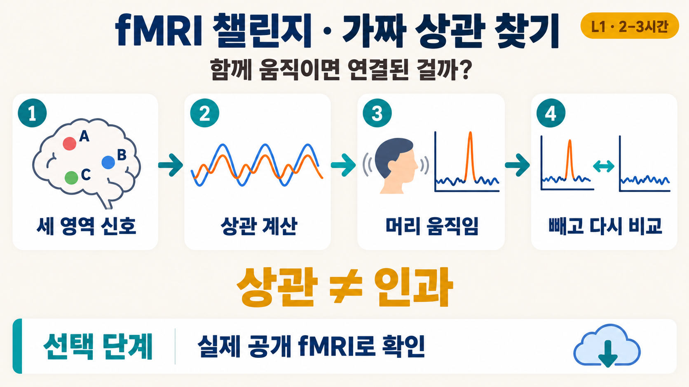

# fMRI · 뇌 영역의 신호는 함께 움직일까?



*그림 오른쪽 위의 시간은 합성 데이터 과제 기준입니다. 실제 공개 데이터 단계(선택)는 약 1시간이 더 걸립니다.*

- 난이도: **L1** (안내를 따라 실행하고, 본 것을 설명하는 과제)
- 데이터: **연습용 합성 fMRI**(실제 사람의 뇌 영상이 아니며, 세 영역 A·B·C 중 어느 둘이 연결되어 있는지 정답 파일이 함께 만들어짐). 선택 단계에서 **실제 공개 fMRI**(OpenNeuro ds000228의 nilearn 전처리본, 4명 fMRI 약 24 MB + 뇌 지도 약 26 MB, 정답 없음)를 씁니다.
- 필요한 것: 노트북 컴퓨터(GPU 없어도 됨), Python 3.11 또는 3.12, 인터넷(패키지 설치와 공개 데이터 다운로드용), 디스크 여유 200 MB 이상(패키지 설치 공간은 별도, 시작 안내 참고)
- 예상 시간: 설치와 첫 실행 30분 안팎, 합성 과제 2–3시간 + 실제 데이터(선택) 약 1시간 (추정)

## 무엇을 해 보나요?

fMRI는 뇌를 작은 정육면체(**복셀**)로 나누고, 몇 초 간격으로 각 복셀의 신호를 반복해서 찍습니다. 신호는 혈액 속 산소 수준을 따라 변하므로 뇌 활동을 간접적으로 보여 줍니다. 이 과제에서는 두 영역의 신호가 함께 오르내리는 정도(상관계수)를 계산합니다. 그리고 머리 움직임이 관계없는 영역 사이에 가짜 상관을 만드는 함정을 직접 찾아냅니다.

## 시작하기

처음이라면 [시작 안내](../START_HERE.md)의 설치 단계를 먼저 따라 해 주세요. 설치가 끝났다면 저장소 맨 위 폴더에서 아래를 실행합니다. EEG 챌린지를 마치고 `challenges/eeg` 폴더에 있다면 첫 줄 대신 `cd ../fmri`를 실행합니다.

```bash
cd challenges/fmri
python generate_synthetic_fmri.py
jupyter notebook fmri_synthetic_example.ipynb
```

`data/` 폴더에 4D 영상(`bold.nii.gz`), 영역 표시(`rois.nii.gz`), 머리 움직임 표(`confounds.tsv`), 정답(`ground_truth.json`)이 20초 안팎으로 만들어집니다. 생성 중에 `EstimationWarning`, `start_params` 같은 경고가 수백 줄 나올 수 있습니다. 마지막 줄에 정답 상관계수가 함께 출력됩니다. 미리 보고 싶지 않다면 "저장 위치" 줄까지만 확인하세요. 그 줄이 나오면 성공입니다. 정답 파일은 분석을 마친 뒤에 여세요. 데이터를 만드는 방법은 [합성 데이터 안내](fmri/README.md)에 있습니다.

## 과제

1. 예제 노트북을 위에서부터 실행하며 영상의 크기와 시점 간격(TR, 한 번 찍고 다음에 찍기까지의 시간)을 확인합니다. 노트북은 크기를 (x, y, z, 시간) 순서로 보여 줍니다. 앞의 세 수를 곱하면 복셀 수입니다.
2. 세 영역의 시계열을 뽑아 그리고, 세 쌍의 상관계수를 계산합니다.
3. 머리 움직임 크기(FD, framewise displacement)를 그리고, 움직임이 큰 시점을 뺀 뒤 상관계수가 어떻게 바뀌는지 설명합니다.
4. `ground_truth.json`과 비교해 어느 쌍이 실제로 연결되어 있었는지, 움직임을 빼기 전과 후 중 어느 쪽이 정답에 가까운지 쌍마다 적습니다. 모든 쌍이 정답에 가까워지지는 않습니다. 가까워지지 않은 쌍이 있다면 그 이유를 생각해 봅니다.
5. 새 데이터로 다시 해 봅니다(노트북 마지막 칸의 "다른 데이터로 반복"). 아래 명령으로 다른 seed의 데이터를 만들고, 노트북에서 `"data/`로 시작하는 경로 네 곳을 `"data_seed7/`로 바꿔 같은 분석을 반복합니다.

```bash
cd challenges/fmri   # 이미 이 폴더라면 건너뜁니다
python generate_synthetic_fmri.py --seed 7 --out data_seed7
```

## 스스로 확인하기

정답이 들어 있습니다. 분석을 마친 뒤 펼쳐 보세요.

<details><summary>확인용 숫자</summary>

- 기본 데이터(seed 42)의 정답 상관계수는 A–B 0.568, A–C −0.122, B–C −0.144입니다. 움직임을 빼기 전에는 세 쌍 모두 양의 상관이 보입니다.
- 예제 노트북 기준(FD 0.5 mm 초과 시점과 그 다음 시점 제외)으로 200개 시점 중 180개가 남으면 설치가 제대로 된 것입니다. 이때 상관계수는 움직임 제거 전 A–B 0.64, A–C 0.41, B–C 0.33이고, 제거 후 0.41, −0.01, −0.16입니다. A–C와 B–C는 정답에 가까워지지만, A–B는 오히려 정답(0.568)에서 멀어집니다. 왜 그런지 과제 4에서 설명해 보세요.
- seed 7 데이터의 정답은 A–B 0.642, A–C −0.119, B–C −0.106이고, 같은 기준으로 180개 시점이 남습니다.
- 움직임을 빼도 정답과 완전히 같아지지 않는 이유(잡음, 시점 수)를 설명할 수 있으면 과제를 이해한 것입니다.

</details>

## 실제 공개 데이터로 확인하기

합성 데이터에서 연습한 분석을 실제 사람의 fMRI에 적용합니다. 데이터는 OpenNeuro에 공개된 ds000228입니다. 3–12세 어린이와 성인이 짧은 애니메이션 영화를 보는 동안 찍은 영상입니다. nilearn은 이 데이터를 fMRIPrep으로 전처리하고 4 mm 복셀로 줄인 판을 머리 움직임 표(confounds)와 함께 내려받게 해 줍니다. 합성 데이터와 달리 **정답 파일이 없습니다.**

### 받는 방법

설치는 합성 데이터 과제와 같습니다. `challenges/fmri` 폴더에서 아래를 실행합니다.

```bash
jupyter notebook fmri_real_data.ipynb
```

노트북의 1·2단계 칸이 `nilearn.datasets.fetch_development_fmri`로 4명(성인 1명, 어린이 3명)의 데이터를 받고, 영역을 고를 Harvard-Oxford 아틀라스(뇌를 이름 붙은 구역으로 나눈 지도)도 받습니다. 데이터는 노트북 옆 `data_real/` 폴더에 저장되며, 다음 실행부터는 다시 받지 않습니다. 저장 위치는 노트북의 `DATA_DIR` 한 줄로 바꿉니다.

- 용량: 내려받는 양 약 50 MB(fMRI 약 24 MB, 아틀라스 압축 파일 약 26 MB), 압축을 푼 뒤 디스크 약 53 MB
- 시간: 첫 실행 약 4분 30초(그중 아틀라스 내려받기 약 2분 20초), 데이터를 받아 둔 뒤 다시 실행하면 5초 안팎
- 위 값은 2026-10-09에 한 번 잰 값입니다. 내려받는 시간은 네트워크에 따라 크게 다릅니다.

### 할 일

1. **합성 데이터에서 쓴 분석을 그대로 적용합니다.** 영역 세 개(A=왼쪽 운동 영역, B=오른쪽 운동 영역, C=왼쪽 뒤통수 시각 영역)의 시계열을 뽑고, 세 쌍의 상관계수를 계산합니다. FD 0.5 mm 초과 시점과 그 다음 시점을 뺀 뒤 다시 계산합니다.
2. **사람마다 움직임 양과 상관 변화를 비교합니다.** 누가 많이 움직였나요? 움직임을 뺐을 때 상관계수가 크게 바뀐 사람은 누구이고, 어느 방향으로 바뀌었나요? 합성 데이터에서 본 변화와 같은 방향인가요?
3. **정답이 없는 실제 데이터에서 무엇을 믿을 수 있는지 설명합니다.** 여러 사람에게서 같은 방향으로 나오는 결과, 움직임을 빼도 크게 바뀌지 않는 결과, 이미 알려진 사실과 맞는 결과를 생각해 보세요. 그리고 4명이라는 사람 수로 말할 수 있는 것과 없는 것을 적습니다.

노트북은 움직임 신호를 시계열에서 빼는 처리(confounds 회귀)를 하지 않습니다. 또 시계열 전체에 필터를 건 뒤에 시점을 빼므로, 큰 움직임의 영향이 필터를 거쳐 이웃 시점에 퍼진 부분은 남습니다. 시점을 빼는 것만으로 움직임의 영향이 모두 사라졌다고 볼 수 있는지 생각해 보세요. "좌우 운동 영역은 함께 움직인다"처럼 알려진 사실과 맞는 결과도, 머리 움직임이나 뇌 전체 신호가 넓은 범위에 양의 상관을 만들 수 있으므로 그것만으로 믿을 근거가 되지는 않습니다.

**TR 주의:** 이 파일들의 머리말(header)에는 TR이 1초로 적혀 있지만 실제 촬영 간격은 2초입니다. 노트북은 2초를 직접 넣습니다. 실제 데이터에서는 파일에 적힌 값도 원본 설명과 맞는지 확인해야 합니다.

### 이용 조건과 인용

- 학생이 실제로 받는 파일은 nilearn이 OSF에 올린 전처리본입니다. nilearn의 데이터 설명은 이 전처리본을 "비상업 연구 목적으로 제한 없이 사용(usage is unrestricted for non-commercial research purposes)"이라고 적습니다. 상업적 용도로는 쓰지 마세요.
- 원본 데이터: OpenNeuro ds000228 버전 1.1.1, 라이선스 **CC0**. [데이터 페이지](https://openneuro.org/datasets/ds000228/versions/1.1.1), DOI [10.18112/openneuro.ds000228.v1.1.1](https://doi.org/10.18112/openneuro.ds000228.v1.1.1)
- 데이터 제공자가 요청한 인용(원문): "Richardson, H., Lisandrelli, G., Riobueno-Naylor, A., & Saxe, R. (2018). Development of the social brain from age three to twelve years. Nature communications, 9(1), 1027." [논문](https://www.nature.com/articles/s41467-018-03399-2)
- [nilearn `fetch_development_fmri` 문서](https://nilearn.github.io/stable/modules/generated/nilearn.datasets.fetch_development_fmri.html)도 같은 논문을 인용하도록 안내합니다.
- 영역을 고를 때 쓰는 **Harvard-Oxford 아틀라스**는 FSL 라이선스를 따르며 비상업 목적에만 무료입니다([FSL 라이선스](https://fsl.fmrib.ox.ac.uk/fsl/docs/#/license?id=fsl-license)). nilearn 문서가 안내하는 인용:
  - Makris, N., et al. (2006). Decreased volume of left and total anterior insular lobule in schizophrenia. *Schizophrenia Research*, 83, 155–171. https://doi.org/10.1016/j.schres.2005.11.020
  - Frazier, J. A., et al. (2005). Structural brain magnetic resonance imaging of limbic and thalamic volumes in pediatric bipolar disorder. *American Journal of Psychiatry*, 162, 1256–1265. https://doi.org/10.1176/appi.ajp.162.7.1256
  - Desikan, R. S., et al. (2006). An automated labeling system for subdividing the human cerebral cortex on MRI scans into gyral based regions of interest. *NeuroImage*, 31, 968–980. https://doi.org/10.1016/j.neuroimage.2006.01.021
  - Goldstein, J. M., et al. (2007). Hypothalamic abnormalities in schizophrenia: sex effects and genetic vulnerability. *Biological Psychiatry*, 61, 935–945. https://doi.org/10.1016/j.biopsych.2006.06.027
- 결과를 공유할 때 데이터 이름(ds000228), 위 논문, 아틀라스 인용을 함께 적어 주세요. 받은 데이터 파일은 이 저장소나 결과물에 올리지 마세요.

### 실제 데이터 확인용 숫자

이 데이터에는 정답이 없습니다. 아래 숫자는 설치와 분석이 제대로 되었는지 확인하는 용도입니다.

<details><summary>확인용 숫자</summary>

조건: 4명(sub-pixar123, sub-pixar001, sub-pixar002, sub-pixar003), 사람마다 168개 시점, TR 2초, FD 0.5 mm 초과 시점과 그 다음 시점 제외, confounds 회귀 없음, nilearn 0.14.1.

| 사람 | 구분(나이) | 평균 FD (mm) | FD 0.5 mm 초과 시점 | 남은 시점 | A–B 전 → 후 | A–C 전 → 후 | B–C 전 → 후 |
| --- | --- | --- | --- | --- | --- | --- | --- |
| sub-pixar123 | 성인(27) | 0.16 | 1 | 166 | 0.77 → 0.76 | 0.36 → 0.37 | 0.35 → 0.35 |
| sub-pixar001 | 어린이(4.8) | 0.39 | 27 | 129 | 0.56 → 0.80 | 0.68 → 0.72 | 0.52 → 0.73 |
| sub-pixar002 | 어린이(4.9) | 0.34 | 26 | 131 | 0.69 → 0.66 | 0.31 → 0.38 | 0.39 → 0.25 |
| sub-pixar003 | 어린이(4.2) | 0.33 | 27 | 125 | 0.93 → 0.94 | 0.58 → 0.58 | 0.67 → 0.66 |

- 움직임이 적은 성인은 거의 바뀌지 않습니다.
- 어린이 세 명은 시점을 37–43개씩 잃지만, 상관계수가 바뀌는 방향은 사람과 쌍마다 다릅니다. sub-pixar001은 A–B와 B–C가 크게 오르고, sub-pixar002는 B–C가 내려갑니다.
- 합성 데이터에서는 움직임을 빼면 가짜 상관이 줄었습니다. 실제 데이터에서도 늘 그렇다고 가정하지 마세요. 왜 다르게 나올 수 있는지가 할 일 3의 출발점입니다.

</details>

## 정리해 둘 것

- 시계열 그림 1장
- 세 쌍의 상관계수(움직임 제거 전·후)와 해석
- 실행한 노트북
- "A와 B의 상관이 높다"는 사실만으로 "A가 B를 움직인다"고 말할 수 없는 이유를 두세 문장으로

공유하는 방법은 [시작 안내](../START_HERE.md#5-결과-정리와-공유)에 있습니다.

## 선택 심화

움직임 기준값을 0.2 mm나 1.0 mm로 바꾸면 남는 시점 수와 상관계수가 어떻게 달라지나요? 기준을 엄하게 할 때 얻는 것과 잃는 것을 적어 보세요. 0.3 mm처럼 결과가 0.5 mm와 똑같이 나오는 기준도 있습니다. 그렇다면 FD 그래프를 보고 이유를 찾아보세요.

## 합성 데이터의 한계

합성 fMRI는 잡음 수준, 공간 smoothness, 영역 간 상관, 머리 움직임 같은 몇 가지 특성만 실제와 비슷하게 맞춘 것입니다. 영역에는 해부학적 이름이 없고 표준 뇌 공간에 정렬되어 있지 않습니다. 이 데이터에서 잘 되는 방법이 실제 영상에서도 그대로 잘 된다고 가정하지 마세요. 자세한 한계는 [합성 데이터 안내](fmri/README.md#한계)에 있습니다.

## 용어

- **영역(ROI)**: 신호를 평균해 하나의 시계열로 만드는 복셀 묶음. 이 데이터에서는 A·B·C 세 개입니다.
- **시계열**: 시점마다 잰 값을 시간 순서로 늘어놓은 것.
- **FD(framewise displacement)**: 바로 앞 시점과 비교한 머리 움직임의 크기(mm).
- **scrubbing**: 움직임이 큰 시점을 분석에서 빼는 처리.
- **detrend·high-pass**: 스캐너에서 생기는 아주 느린 신호 변화(drift)를 없애는 처리.

## 나와 연구의 fit 돌아보기

어떤 과정이 재미있었나요? 무엇이 어려웠나요? 결과를 더 믿으려면 무엇을 확인하고 싶나요?
