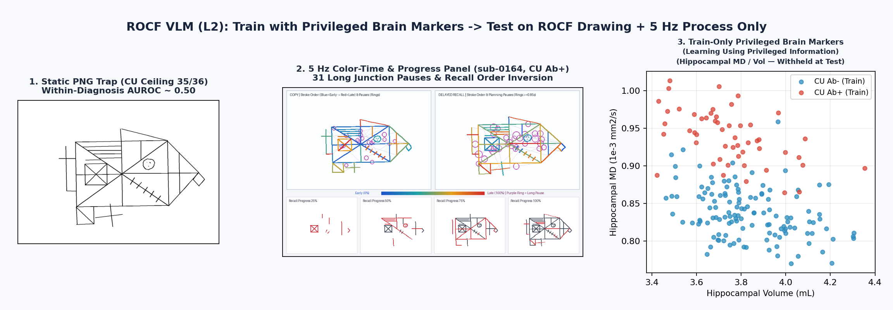
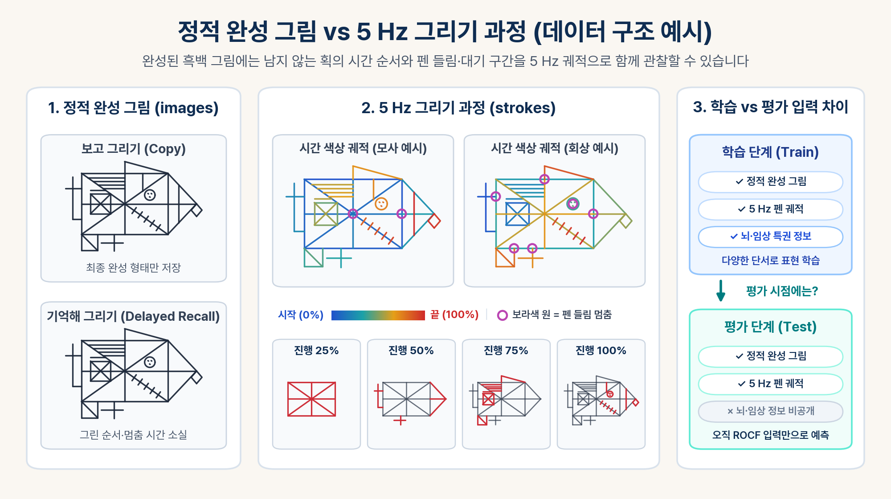

# ROCF VLM · 복합도형 그리기 과정으로 아밀로이드 베타 예측하기

- **난이도**: L2 (예상 4–6시간) · **환경**: 노트북 CPU (Colab T4 GPU 호환) · **안내**: [코드북](rocf_vlm/CODEBOOK.md) · [데이터 안내](rocf_vlm/README.md) · [설치·제출](../START_HERE.md#5-결과-정리와-공유)

## 왜 이 문제를 푸는가

알츠하이머병의 핵심 병리 물질인 아밀로이드 베타 단백질은 기억력 저하가 겉으로 드러나기 수년 전부터 뇌에 서서히 쌓입니다. 이를 가장 정확히 확인하는 **PET**(양전자단층촬영) 검사는 비용이 비싸고 방사성 추적자를 혈관에 주사해야 해 대규모 조기 선별에 쓰기 어렵습니다.

**ROCF**(Rey–Osterrieth Complex Figure, 레이-오스테리에트 복합도형 검사)는 복잡한 기하 도형을 먼저 보고 따라 그린 뒤, 잠시 후 기억만으로 다시 그리는 신경심리검사입니다. 그런데 완성된 그림만 보면 인지 기능이 정상 범위인 참가자들이 대부분 높은 점수에 몰리고, 인지 저하가 이미 시작된 집단과의 차이에 모델이 기대는 교란도 생기기 쉽습니다.

디지털 태블릿에 초당 5회(5 Hz) 기록되는 펜의 움직임에는 획을 긋는 순서와 중간에 펜을 떼고 멈추는 시간처럼 완성 그림에서는 사라지는 시공간 계획의 흔적이 남습니다. 여기에 학습할 때만 MRI 뇌지표와 임상 정보를 함께 참고하고, 실제 예측할 때는 태블릿 그림과 펜 궤적만 사용하는 **특권 정보 활용 학습**(Learning Using Privileged Information)을 적용하면 뇌 촬영 없이도 병리 신호를 잡아낼 수 있는지 검증해 볼 수 있습니다.

## 과제

제공된 합성 데이터(`challenges/rocf_vlm/data.zip`)로 모델을 학습한 뒤, 평가 대상 참가자의 **ROCF 완성 그림과 5 Hz 펜 그리기 과정만** 입력받아 아밀로이드 베타 양성 확률을 예측하세요. 아울러 그 예측력이 실제 그리기 과정에서 나오는지 스스로 검증하고 결과를 보고합니다.

- **학습과 평가의 분리**: 뇌영상·임상 정보는 학습 데이터에만 포함되어 있으며 평가 대상에는 제공되지 않습니다(평가 정답 비공개). 학습 단계에서 교란 통제·보조 학습·표현 정렬 등에 자유롭게 활용하되, 추론 코드는 그림과 펜 궤적만 입력받도록 작성합니다.
- **자체 검증**: 집단 구성 차이나 우연이 아니라 실제 그리기 과정의 시간·순서에서 예측력이 나오는지 학습 데이터 안에서 교차검증과 대조 검증을 설계해 확인합니다. 개발 중 시각-언어 모델(VLM)로 그리기 과정 그림을 탐색할 수 있으나, 최종 제출 코드는 외부 API 없이 오프라인으로 실행되어야 합니다.
- **결과 보고**: 모델이 포착한 과정 단서와 자체 검증 결과, 그리고 한계를 근거와 함께 간결히 정리합니다.

## 실행과 제출 규격

[설치 안내](../START_HERE.md#4-설치와-첫-실행-30분-안팎)를 마친 뒤, 저장소에 포함된 사전 생성 합성 데이터(`data.zip`)의 압축을 풀고 기준선 파이프라인과 규격 점검기를 실행합니다. 전체 파일 구조, 열 정의, 용어 풀이는 [코드북](rocf_vlm/CODEBOOK.md)에 있습니다.

```bash
cd challenges/rocf_vlm
python -m zipfile -e data.zip .
python starter_pipeline.py --data-dir data --out-dir outputs --device cpu
python smoke_test.py --pipeline starter_pipeline.py --device cpu
```

| 구분 | 필수 파일·인자 규격 | 핵심 제약 |
| --- | --- | --- |
| 실행 명령 | `python run_pipeline.py --data-dir <dir> --out-dir <dir> --device {cpu,cuda} --seed <int>` | 오프라인(`OPENROUTER_API_KEY=""`), 600초·16 GB 이하, 사전 가중치 파일 금지 |
| 예측 결과 | `predictions.csv` (`subject_id`, `y_prob` 2열) | 평가 대상 전원 포함, `[0.0, 1.0]`, 결측 금지 |
| 판정 요약 | `summary.json` (`claim_signal` 불리언, `method_summary` 문자열) | 추가 진단 키 선택 허용 |

**2026 동계 인턴십 2단계 지원자**는 공개 Issues나 공개 저장소에 코드와 비공개 주소를 올리지 말고 [시작 안내 5절](../START_HERE.md#5-결과-정리와-공유)의 비공개(Private) 저장소·메일 절차를 따르세요.

## 참고 그림

<p align="center">
  
  
</p>
